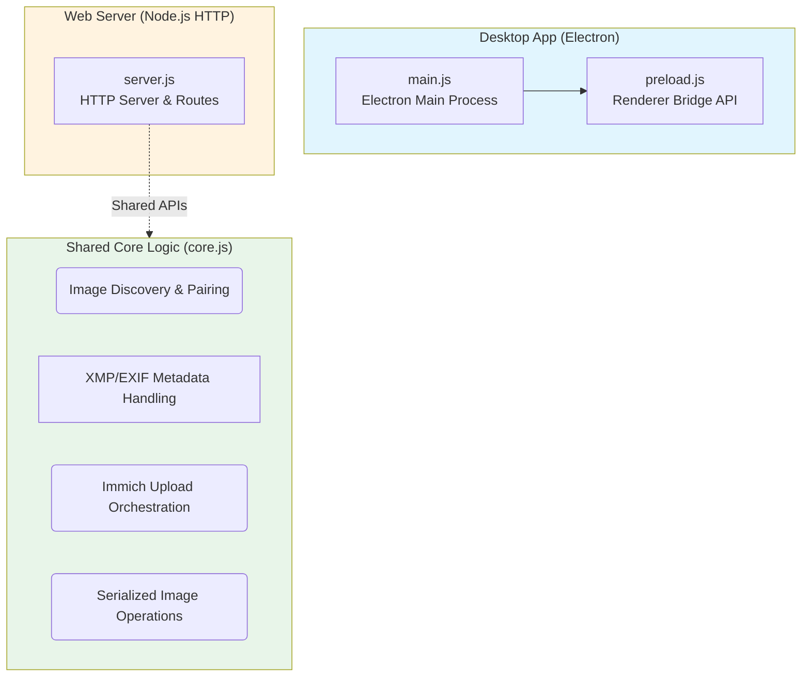
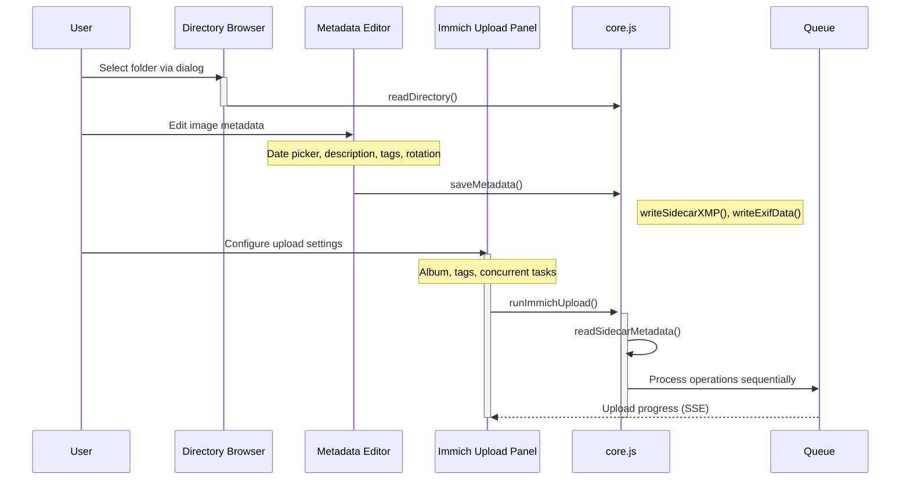

# Image Parser

Image Parser is a desktop and web application for reviewing paired images (A/B side-by-side comparisons), editing metadata (EXIF/XMP sidecars), and uploading image folders to Immich.

## Features

- **A/B Pair Comparison**: Review paired images with A/B side-by-side comparison, supporting common scan naming conventions (`*_a.*` / `*_b.*`, `*_front.*` / `*_back.*`).
- **Metadata Editing**: Edit EXIF dates embedded in image files and XMP sidecar metadata (description, tags, orientation).
- **Immich Upload**: Batch upload paired images and videos to Immich with configurable albums, tags, and concurrent
  tasks. immich-go's folder upload includes videos, and the `_exclude` "Do not upload" names apply to them too.
- **Video Compression (optional)**: Turn on "Compress videos before uploading" in the Immich settings to re-encode
  each standalone video before the upload, **replacing the original file**. The output follows the recommended
  settings for digitized tape: MP4, H.265 (CRF 23–26, default 24) or H.264 (CRF 20–23, default 21), the medium or
  slow preset, the native resolution (never upscaled), the source frame rate as a constant frame rate, and AAC-LC
  audio at 128–192 kbps (default 160) with the source's channels. A `.mov`/`.mkv`/… becomes `.mp4` and its sidecar
  is renamed to match; the file date and recording date are kept. An original is replaced only after the new file
  is complete and smaller. Live photo videos, videos flagged "Do not upload", and videos Image Parser already
  compressed are skipped. If any video cannot be compressed, the upload does not start.
- **Image Rotation**: Apply rotation corrections to both file metadata and pixel data where supported.
- **Videos and Live Photos**: `.mp4`, `.m4v`, `.mov`, `.webm` and `.mkv` files appear in the grid with a play badge
  and their length, and play in Review with seek-bar previews. An image and a video with the same name in the same
  folder (`IMG_1.jpg` + `IMG_1.mov`) form a live photo: the grid shows the still with a "Live" mark, and Review has a
  Still/Video switch. Scanned A/B pairs are never matched with videos. Videos play as stored (never transcoded); a
  codec the browser cannot play shows a message with a download link. Videos cannot be rotated.
- **Processed Folders**: Mark a folder (optionally with all its subfolders) as processed from the main screen or after an Immich upload; the folder browser shows a checkmark next to processed folders.
- **Cross-Platform**: Desktop app for Windows/macOS/Linux via Electron; web server version for TrueNAS/Docker or local deployment.

## Architecture



### Component Interaction Flow



## Desktop Deployment (Electron)

### Prerequisites

- Node.js LTS 20.19+ or 22.12+
- `immich-go` binary installed and available on PATH

### Installation

Double-click `install.bat` (or run `install.bat /nopause` from a terminal). It will:

1. Install Node.js LTS and `immich-go` via `winget` if missing
2. Run `npm install` and `npm run build`
3. Create an **Image Parser** shortcut on your desktop

### Development

```bash
npm run dev   # Start Vite dev server with Electron hot reload
npm start     # Run Electron against existing build
```

The Electron app loads from the built UI in `dist/`. During development, it falls back to the Vite dev server at `http://localhost:5173`.

### Security

Desktop app uses Windows/macOS secure storage to encrypt Immich API keys. Keys are decrypted only in memory and never logged.

## Web Deployment (Node.js HTTP Server)

### Docker / TrueNAS

Create a stack from `docker-compose.yml`. Configure these environment variables:

| Variable                   | Example                      | Purpose                                   |
| -------------------------- | ---------------------------- | ----------------------------------------- |
| `IMAGEPARSER_PHOTOS_DIR`   | `/mnt/tank/photos/scans`     | Photo dataset (mounted at `/data`)        |
| `IMAGEPARSER_CONFIG_DIR`   | `/mnt/tank/apps/imageparser` | Settings + encryption key storage         |
| `PUID` / `PGID`            | `568` / `568`                | Owner of the photo dataset                |
| `IMAGEPARSER_PORT`         | `8080`                       | Host port for the web UI                  |
| `IMAGEPARSER_USERNAME`     | `admin`                      | Optional HTTP Basic auth user             |
| `IMAGEPARSER_PASSWORD`     | _(strong password)_          | Enables auth when set (recommended)       |
| `IMAGEPARSER_DEBUG`        | `false`                      | Streams server logs to the browser        |
| `IMAGEPARSER_TAG`          | `latest`                     | Image tag to run (default `latest`)       |
| `IMAGEPARSER_GEOCODER_URL` | `https://photon.komoot.io`   | Optional place-search service (see below) |

#### Immich settings for every user (optional)

An administrator can set the Immich server and admin key once for every user instead of each user typing them in:

| Variable                    | Example                      | Purpose                                                        |
| --------------------------- | ---------------------------- | -------------------------------------------------------------- |
| `IMMICH_URL`                | `https://immich.example.com` | Immich server for all users; the field becomes read-only       |
| `IMMICH_ADMIN_API_KEY`      | _(admin API key)_            | Pauses Immich jobs during every upload; the field is hidden    |
| `IMMICH_ADMIN_API_KEY_FILE` | `/run/secrets/immich_admin`  | File holding the admin key; takes precedence over the variable |

- These values override what users saved. The admin key is never sent to the browser, written to `/config`, or
  shown in logs. Create it on a **dedicated Immich admin account**: it gives admin rights for every upload.
- The server refuses to start if `IMMICH_URL` is not an `http://` or `https://` URL, or if
  `IMMICH_ADMIN_API_KEY_FILE` cannot be read or is empty.
- With single sign-on, each user's own Immich API key can also come from Authentik; see
  [Single sign-on with Authentik](#single-sign-on-with-authentik).
- The desktop app ignores these variables and keeps using OS secure storage.

Resized previews are cached in `preview-cache/` inside the config directory and trimmed when the cache grows past
1 GB. Set `IMAGEPARSER_PREVIEW_CACHE_MB` on the container to change the limit. The folder is safe to delete.

#### Place search for photo locations (optional)

Photos can be tagged with a place (a school, church or town). The place search uses
[Photon](https://photon.komoot.io), which is built on OpenStreetMap data and has no per-call fees. By default the
public `https://photon.komoot.io` server is used. Set `IMAGEPARSER_GEOCODER_URL` to the base URL of your own
Photon-compatible server (`<url>/api?q=...`) to avoid the public one; the server refuses to start if the value is
not an `http://` or `https://` URL.

To keep the load on the service very low, a search runs only when the user presses Enter or the Search button, at
least 3 characters are required, results are cached in memory and in `geocode-cache.json` in the config directory,
requests are limited to one per second, and choosing a result never makes another call. The place is written to the
photo's XMP sidecar as `exif:GPSLatitude` / `exif:GPSLongitude`, which Immich reads. Place data is © OpenStreetMap
contributors.

For single sign-on with per-user folders, set the `OIDC_*` variables instead of the Basic auth pair; see
[Single sign-on with Authentik](#single-sign-on-with-authentik).

Open `http://<truenas-ip>:8080`, click the folder button, and browse the mounted photo share.

The image bundles the official `immich-go` Linux release from
[simulot/immich-go](https://github.com/simulot/immich-go/releases), verified against the release checksums. To
build with a different release, pass `--build-arg IMMICH_GO_VERSION=x.y.z` to `docker build`.

### Debugging

Set `IMAGEPARSER_DEBUG=true` (in the stack's `.env` file, with `docker run -e`, or at build time with
`--build-arg IMAGEPARSER_DEBUG=true`) and restart the container. Then open the web UI, open the browser developer
tools, and watch the **Console** for entries prefixed with `[server]`:

- Startup diagnostics: Node version, user ID, whether `/data` and `/config` are writable, whether the CA
  certificate bundle exists, and the `immich-go version` output.
- Each API request with its status and duration.
- Each Immich upload: the `immich-go` command (API keys shown as `[REDACTED]`), its output at debug level, and the
  exit code or signal.

Common container-only Immich upload failures:

- `x509: certificate signed by unknown authority`: `immich-go` uses the system certificate store, so the server's
  HTTPS certificate must be trusted inside the container.
- `connection refused` / `no such host`: `localhost` inside the container is the container itself; use the Immich
  server's LAN IP address or hostname.
- Exit by `SIGKILL`: usually out of memory; lower the concurrent task count.

Turn debugging off again afterwards. Without single sign-on, any user who can sign in to the web UI can read the log
stream; with single sign-on, only members of the admin group can.

#### Validating a pull request image

Every pull request opened from a branch in this repository publishes
`ghcr.io/sevarg11-org/imageparser:pr-<number>`, updated on each push to the PR. (Pull requests from forks are built
but not published.) To try one before it merges, set `IMAGEPARSER_TAG=pr-<number>` in the stack's `.env` and
redeploy, then set it back to `latest` when done. Point `IMAGEPARSER_PHOTOS_DIR` at a test copy of your photos, since
the PR build will write metadata to them.

### Single sign-on with Authentik

The web server can sign users in with OpenID Connect (authorization code flow with PKCE). Each user then sees only
the folders granted to them, including all subfolders, and keeps their own Immich settings and API keys.

This section is a summary. For a full walkthrough with every Authentik screen, verification steps, and
troubleshooting, see [docs/Authentik-Setup.md](docs/Authentik-Setup.md).

**Requirements:** serve Image Parser through a reverse proxy with HTTPS (for example
`https://photos.example.com`). While sign-in is on, `IMAGEPARSER_USERNAME`/`IMAGEPARSER_PASSWORD` are ignored;
keep them set as backup credentials for [emergency access](#emergency-access-when-the-identity-provider-is-down).

1. In Authentik, create a **Scope Mapping** (Customization → Property Mappings) with scope name `imageparser` and
   this expression. It merges the folder lists of the user and their groups, and sends the user's admin flag:

   ```python
   def grants(attributes):
       value = attributes.get("imageparser_folders", [])
       return [value] if isinstance(value, str) else list(value)

   folders = grants(request.user.attributes)
   for group in request.user.ak_groups.all():
       folders.extend(grants(group.attributes))
   return {
       "imageparser_folders": sorted(set(folders)),
       "imageparser_admin": request.user.attributes.get("imageparser_admin") is True,
       "immich_api_key": request.user.attributes.get("immich_api_key", ""),
   }
   ```

2. Create an **OAuth2/OpenID Provider**: client type _Confidential_, redirect URI
   `https://photos.example.com/auth/callback` (strict), and a **Signing Key** (for example the
   "authentik Self-signed Certificate"). The signing key is required: Image Parser verifies ID token signatures
   against the provider's published keys and rejects HS256 tokens, which is what Authentik issues without a key.
   Under _Advanced protocol settings → Scopes_ add the
   `imageparser` mapping next to the default `openid`, `profile`, and `email` mappings. Create an **Application** for
   the provider and bind the users or groups who may sign in.
3. Grant folders by adding an attribute to a user or group, relative to `/data`:

   ```yaml
   imageparser_folders:
     - family
     - scans/2023
   ```

   A folder that does not exist grants nothing; `..` and similar entries are ignored.

   **Admin users** see every folder in the share, including other users' folders, and can read the debug log. Make
   a user an admin in either way:
   - add them to the `imageparser-admin` group (sent in the default `groups` claim), or
   - set the attribute `imageparser_admin: true` on the user (sent by the mapping above).

   **Immich API keys (optional):** set `immich_api_key: <the user's Immich API key>` on a user. Users with the
   attribute upload without entering a key, and the API key field is hidden for them. Users without it enter
   their own key as before.

4. Set these variables in the stack's `.env` and redeploy:

| Variable                       | Example                                                | Purpose                                     |
| ------------------------------ | ------------------------------------------------------ | ------------------------------------------- |
| `OIDC_ISSUER_URL`              | `https://auth.example.com/application/o/image-parser/` | Provider issuer; setting it enables sign-in |
| `OIDC_CLIENT_ID`               | _(from the provider)_                                  | OAuth client ID                             |
| `OIDC_CLIENT_SECRET`           | _(from the provider)_                                  | OAuth client secret                         |
| `OIDC_REDIRECT_URI`            | `https://photos.example.com/auth/callback`             | Public callback URL registered above        |
| `OIDC_SCOPES`                  | `openid profile email imageparser`                     | Scopes to request                           |
| `OIDC_ADMIN_GROUP`             | `imageparser-admin`                                    | Group with access to the whole share        |
| `OIDC_ADMIN_CLAIM`             | `imageparser_admin`                                    | Claim that makes a single user an admin     |
| `OIDC_FOLDERS_CLAIM`           | `imageparser_folders`                                  | Claim listing each user's folders           |
| `OIDC_IMMICH_API_KEY_CLAIM`    | `immich_api_key`                                       | Claim holding a user's own Immich API key   |
| `OIDC_SESSION_HOURS`           | `8`                                                    | Sign-in lifetime                            |
| `OIDC_ALLOW_INSECURE_REQUESTS` | `false`                                                | Allow an HTTP issuer (trusted networks)     |
| `OIDC_DISABLED`                | `false`                                                | Emergency bypass of sign-in (see below)     |

Notes:

- Folder grants and admin membership are read at sign-in. Changes in Authentik apply after the user signs in again
  or the session expires. **Sign out** also ends the Authentik session.
- Session cookies are encrypted with a key derived from `IMAGEPARSER_SECRET_KEY` (or `/config/secret.key`).
  Changing the key signs everyone out.
- The Immich API key from Authentik is never saved: not in `/config`, not even encrypted, and not in logs. It is
  kept only in the user's encrypted session cookie, which the browser cannot read, and is read again at each
  sign-in.
- Per-user Immich settings are stored in `/config/users/<id>/immich-settings.json`, where `<id>` is a hash of the
  user's Authentik ID. The shared `/config/immich-settings.json` used without sign-on is not migrated.
- If Authentik uses a certificate from a private CA, mount the CA certificate and set `NODE_EXTRA_CA_CERTS` to its
  path inside the container.

#### Emergency access when the identity provider is down

If Authentik is unavailable or misconfigured, set `OIDC_DISABLED=true` in the stack's `.env` and redeploy. The rest
of the `OIDC_*` settings can stay in place.

- If `IMAGEPARSER_USERNAME` and `IMAGEPARSER_PASSWORD` are set, the browser asks for those backup credentials (HTTP
  Basic auth). Set them ahead of time so this path is ready.
- If they are not set, **authentication is turned off completely**: anyone who can reach the server has full access
  to every folder and the saved Immich keys. The log warns about this at startup.

While the bypass is on, everyone is an admin, sees the whole share, and uses the shared
`/config/immich-settings.json` instead of their personal Immich settings. Per-user settings are kept, and they come
back when you remove `OIDC_DISABLED` (or set it to `false`) and redeploy.

### Local Server

Build the app first:

```bash
npm run build
```

Then run with environment variables:

```bash
IMAGEPARSER_ROOT=/path/to/photos \
IMAGEPARSER_CONFIG_DIR=./config \
npm run serve
```

Access at `http://localhost:8080`.

### Security Notes

- The web server only serves files under `/data`; paths outside are rejected. With single sign-on, each user is
  further limited to their granted folders.
- `/healthz` answers without credentials so container health checks work; it reveals nothing else.
- No HTTPS is configured in the container; keep it on your LAN or put behind a reverse proxy with TLS.
- API keys are encrypted at rest using AES-256-GCM with per-request authentication.
- Keys set by `IMMICH_ADMIN_API_KEY` or an Authentik `immich_api_key` attribute are never returned to the browser
  or saved to `/config`.

## Metadata Operations

The shared core logic handles:

- **XMP Sidecars**: Create/update `.xmp` files containing description, tags, EXIF dates, and Adobe Photoshop date fields.
- **Embedded EXIF**: Write creation date directly into image files (`.jpg`, `.tif`, etc.) using ExifTool.
- **Rotation**: Apply orientation to metadata (`Orientation` tag) or rotate pixel data for PNG/WebP formats.
- **Video sidecars**: Video files are never edited. A standalone video's metadata is saved only to `name.ext.xmp`
  (for example `clip.mp4.xmp`; the `clip.xmp` form is never used for videos, because it belongs to a live photo's
  image). Saving a live photo writes `IMG_1.jpg.xmp` and an identical `IMG_1.mov.xmp`; the image sidecar is the
  source of truth when reading. Bulk dates, tags, places, "Reset processing" and "Do not upload" renames cover the
  video and its sidecar too.
- **Video previews**: ffmpeg/ffprobe read video lengths and render poster frames and seek-bar sprites, cached with
  the image previews. The binaries are found through `FFMPEG_PATH` / `FFPROBE_PATH`, then the `ffmpeg-static` /
  `ffprobe-static` packages installed for development and Electron, then `PATH` (the Docker image installs
  `ffmpeg` with apt). Without ffmpeg, videos still play but show no poster, length, or seek-bar previews.
- **Folder State**: Store the processed mark, with who set it and when, in a hidden `.imageparser.json` file inside the folder, so every user and both apps see the same state. A missing or unreadable file means the folder is not processed.

## Testing

Unit tests use Node.js's built-in test runner. Add tests as `*.test.mjs` files:

```bash
npm test
```

The GitHub Actions CI workflow runs tests, ESLint, and the production build on pull requests.

## License

MIT
